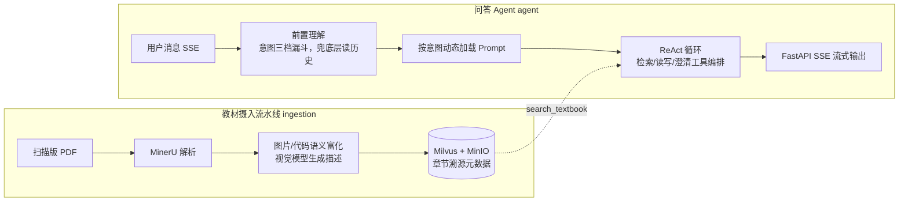

# 研途智学 · Textbook RAG Agent

面向复习备考的教材问答与助手系统：将扫描版计算机教材处理为**可追问、可溯源**的知识库，覆盖教材摄入、混合检索、多轮问答与离线评测四大环节。独立完成前后端与服务化联调。

  

## 核心指标

| 指标 | 结果 | 说明 |
|---|---|---|
| Recall@5（300 题检索评测集） | 79.6% → **84.8%** | 快路径（dense/sparse 混合召回）→ 深度路径（HyDE + RRF + Rerank） |
| 多轮会话评测 | **50 会话 × 200 轮全部通过** | 无会话串扰；检索触发率 88% → 99%，追问轮 hit@5 0.662 → 0.887 |
| 跨轮缓存命中率 | 49% → **92%** | 13 轮会话逐次调用实测：静态壳 + 尾部本轮指令 + 往轮原文回收让断裂点只随轮首前移（数据口径见 `logs/<日期>/metrics.log` 的 `cached`/`input_digest`） |

评测脚本与指标计算均在 [backend/eval/](backend/eval) 内，可离线复现（评测集与教材 PDF 因体积与版权未随仓库分发，见「评测复现」）。

## 架构

系统由两条 LangGraph 流水线组成，共享一套存储（Milvus / PostgreSQL / MinIO）：



### 检索链路（快慢双路径）

- **检索问句**：由模型在 ReAct 循环里结合对话历史自行组织成自包含问句（检索侧无状态，不读历史），不做前置改写，省一次 LLM 往返；
- **快路径**：BGE-M3 dense + sparse 混合召回（WeightedRanker 0.8/0.2），Milvus 单请求完成；
- **深度路径**：在原查询之外并行生成 HyDE 假设文档向量做第二路召回，RRF（k=60）融合两路结果，再过 BGE-Reranker-large 精排；
- **上下文控制**（三层，逐层都只动「发给模型的视图」，不动 state 台账）：
  1. **静态壳 + 尾部本轮指令**：system prompt 只装全局静态内容，教材名/意图/任务目标每轮作为一条尾部 SystemMessage 追加一次——前缀缓存从第一条 token 起命中；
  2. **往轮原文回收**：轮首把上一轮用过的工具原文换成一句占位（判据是「体积过线 + `artifact` 里存着干净原文」，不认工具名单）；原文随 ToolMessage 的 artifact 落 checkpoint 但不进请求，`/history` 回显仍读得到原文；
  3. **会话压缩**：视图逼近模型窗口一半（`MODEL_CONTEXT_WINDOW` / `DEEPSEEK_CONTEXT_WINDOW` × 50%）时，在轮首把更早的历史收成一份中文回顾置顶，水位线之后的消息原样保留；被压掉的消息留在 state 里，回显与审计不受影响。摘要调用失败时保持完整历史（下轮再试），不会用一条报错顶掉对话。
  另有一道 per-session 成本护栏兜底（轮内不设体积闸门：成批取材料的大任务需要它）。

### Agent 能力

- 意图三级漏斗路由（关键词 → embedding 相似度 → LLM 结构化输出兜底），按意图动态装配 system prompt 行为块（工具集固定）；对话历史只喂给兜底层，用于消解「那再来十道」这类省略句；兜底层单独收紧超时且不重试，判不准即回退「讲解」块，不阻塞主链路；
- 工具：`search_textbook`（限定教材检索）、`list_chapters`、`write_file`/`edit_file`/`append_file`（资料生成，Human-in-the-loop 写盘确认）、`clarify`（澄清反问）、联网搜索（MCP）；
- 会话状态经 PostgreSQL checkpointer（`AsyncPostgresSaver`）持久化，`thread_id = user_id:session_id`，支持断流续跑与写盘确认 resume；对话与摄入各用一个独立 schema（`study` / `textbook`）。

## 技术栈

LangGraph / LangChain · FastAPI (SSE) · Milvus 2.4 · PostgreSQL · MinIO · BGE-M3 · BGE-Reranker-large · MinerU · Vue 3 / TypeScript · Docker · uv · pytest / ruff

## 快速开始

```bash
# 1. 启动依赖中间件（Milvus + etcd + MinIO + PostgreSQL + Attu）
#    Attu 在 http://localhost:8002（8000 留给后端）
docker compose -f docker/docker-compose.yml up -d

# 2. 后端：安装依赖并配置环境变量
cd backend
uv sync
cp .env.example .env   # 填 LLM API Key、MinerU Key；POSTGRES_URI 与 compose 默认值保持一致

# 3. 启动后端（启动时初始化 checkpoint 表并预热 BGE-M3 / Reranker）
uv run python -m app.main   # http://localhost:8000, 交互式文档见 /docs

# 4. 前端：另开终端
cd frontend
cp .env.example .env
npm ci
npm run dev                     # http://localhost:5173
```

实际部署建议把 compose、`.env` 和数据都放在仓库外（例如 `/home/ypw/docker/grad_assist/`）：

```bash
docker compose --env-file /home/ypw/docker/grad_assist/.env \
  -f /home/ypw/docker/grad_assist/docker-compose.yml up -d
```

仓库里的 `docker/docker-compose.yml` 只作为参考实例；数据路径默认 `${DATA_ROOT:-./data}`，部署时用外部 `.env` 把 `DATA_ROOT` 指到仓库外目录。

若使用本地 compose 的 Milvus / MinIO，`.env` 里 `MILVUS_URI` 用 `http://localhost:19530`、`MINIO_ENDPOINT` 用 `localhost:9000`，MinIO 凭据与 compose 的 `MINIO_ROOT_USER/PASSWORD` 保持一致；继续用远程存储则保留原值。

`BAAI/bge-m3` 与 `BAAI/bge-reranker-large` 需要先下载到本地目录，并在 `.env` 里用 `EMBEDDING_MODEL_PATH` / `RERANKER_MODEL_PATH` 指向（BGE-M3 的加载代码要求本地目录存在，不会自动从 HuggingFace 拉取）。CPU 环境可将 `EMBEDDING_DEVICE/RERANKER_DEVICE` 保持为 `cpu`；torch 源见 `pyproject.toml` 的 `[tool.uv.sources]`。

### 后端镜像（可选）

`backend/Dockerfile` 仍可单独构建 CPU 镜像；`docker/docker-compose.yml` 已不再包含后端服务，本地开发直接用 `uv run python -m app.main`。

### 主要接口

| 方法 | 路径 | 说明 |
|---|---|---|
| POST | `/upload` | 批量上传扫描版教材 PDF |
| POST | `/resolve` | 执行摄入流水线，SSE 实时进度，支持断点续跑 |
| GET | `/list` | 教材库列表（分页） |
| POST | `/study/chat` | 统一对话入口，SSE 事件流（tool/thought/token/ask_confirm/ask_clarify/done） |
| GET | `/study/files` `/study/file` | 任务产物文件列表与内容读取（路径沙箱校验） |

## 评测复现

```bash
cd backend

# 检索离线消融：300 题（6 本教材 × 50），各配置 Recall/Hit/NDCG/MRR 对比 + 显著性检验
uv run python -m eval.retrieval.run_ablation

# 问题重写消融（历史链路复现）：原问句 vs 当年重写问句单路替换 + 双路 RRF 融合
# 前置重写已下线，此脚本只读旧 metrics.log 复现结论，新日志样本数为 0
uv run python -m eval.retrieval.run_rewrite_ablation

# 多用户多轮会话评测：50 会话 × 200 轮，含延迟/token/检索触发率统计
uv run python -m eval.retrieval.run_multi_user_eval
```

> 评测依赖 `backend/data/` 下的题目集与已入库教材。教材 PDF 与评测集全量数据因版权和体积未上传；如需复现，可用自己的教材走 `/upload → /resolve` 摄入后，参照 [backend/eval/retrieval/dataset.py](backend/eval/retrieval/dataset.py) 的格式构造题目。

## 目录结构

```
backend/
├── app/              # FastAPI + LangGraph 后端
│   ├── main.py       # 应用装配、生命周期与 uvicorn 启动入口
│   ├── api/          # HTTP 适配：router.py 汇总路由，routes/ 只做参数与响应
│   ├── services/     # 应用编排：SSE 流式、HITL 续跑、会话/文件查询
│   ├── agent/  # 问答 Agent：graph 装配、工具、middleware、护栏
│   ├── retrieval/    # 检索能力：向量召回、HyDE、RRF、精排、Milvus 教材存储
│   ├── intent/       # 意图识别能力：三档漏斗与结果实体
│   ├── ingestion/ # 教材摄入流水线：解析、富化、切分入库
│   ├── eval/         # 离线评测：数据集、指标、消融实验
│   ├── prompts/      # 按意图动态加载的 system prompt
│   ├── infra/      # Milvus / PostgreSQL / MinIO 适配
│   ├── ml/           # BGE-M3 / Reranker 模型加载与动态攒批
│   ├── core/         # 横切基础件：日志、提示词加载、安全边界、消息标记
│   └── trace/        # 请求级观测
├── tools/            # 开发期探针（chat_probe 等，不参与服务进程）
├── tests/            # pytest 单测（默认排除 integration 标记的端到端测试）
├── data/             # 评测集与结果（不入库）
├── textbooks/        # 教材 PDF 与解析产物（不入库）
├── study/            # 助手产物（不入库）
└── logs/             # 运行日志（不入库）
frontend/             # Vue 3 + TypeScript 前端（Vite）
docker/               # Milvus 全家桶 + PostgreSQL + MinIO 编排
docs/                 # 设计文档（图片 caption、chunk 对齐修复、网关设计）
```

## 测试与代码检查

```bash
cd backend
uv run pytest            # 单元测试（默认 -m "not integration"，不依赖真实外部服务）
uv run pytest -m integration   # 端到端测试，需 .env 中的真实凭据
uv run ruff check .

cd ../frontend
npm run build            # vue-tsc 类型检查 + Vite 构建
```

push / PR 到 `main` 后由 GitHub Actions 自动执行后端 ruff + pytest 与前端构建（`.github/workflows/ci.yml`）；CI 自带 PostgreSQL 容器，单元测试不依赖本地中间件。依赖由 `backend/uv.lock` 锁定，**修改依赖后需在 `backend/` 下 `uv lock` 并把锁文件一并提交**，否则 CI 的 `uv sync --locked` 会直接失败。
